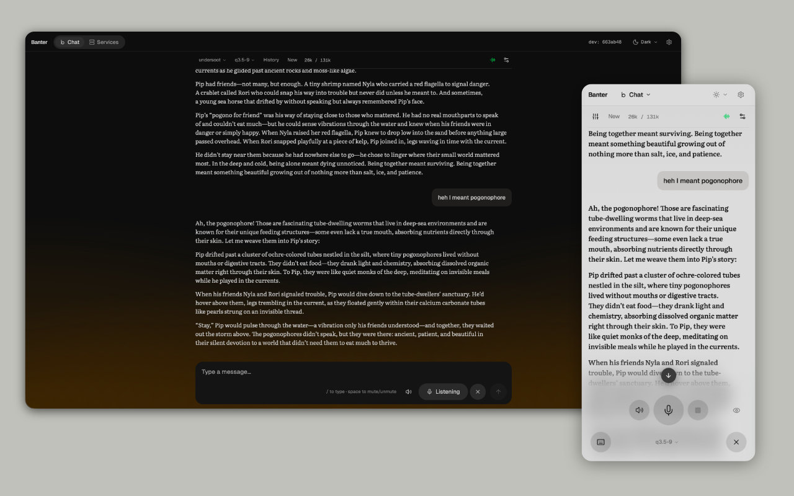

# Banter

A conversational voice interface for agent harnesses, using fully private & self-hosted transcription and speech services of your choice.

It hears when you have actually meant to finish speaking, cleans your speech of fillers, replies as the words are written, and lets you cut in mid-sentence. A control plane can start a speech model when a conversation needs it and unload it when it does not, across as many machines as you point it at.

Built against [OpenClaw](https://docs.openclaw.ai/), and adaptable to other agent harnesses. A [plugin for DeepSeek Harness](docs/guide/plugins/dsh-voice/README.md) is available.



## What it does

**Banter is designed to have fast, natural-feeling conversations, with zero effort. Speech quality is defined by the speech models you choose to run / can afford, and can be run entirely off private models hosted anywhere.**

### Features

**Thoughtful turn-taking.** Most voice interfaces wait a fixed number of milliseconds for silence, so pausing to think cuts you off. Banter runs two ONNX models in the browser: Silero VAD decides when you are speaking, and pipecat's smart-turn decides whether you have finished a thought or merely paused. "I was thinking that…" and "I was thinking that." get different treatment. The reply streams back as audio while it is still being generated, and talking over it cuts the playback and starts a new turn. All this is tunable via `config.json`

**Simultaneous text chat.** Message history, streaming responses, tool calls as expandable cards, and a session list for switching between conversations. Voice is one input mode on that page; turn it off and an ordinary text client remains. There are limitations: it is not a full replacement for a text chat, and doesn't include features like steering, response queues, or file attachments/uploads. The UI is tuned to be a voice-first interface. Unlike the Discord integrations, you get simultaneous voice and text chats, with the ability to use text mid-conversation.

**Full control over your speech and text data.** You install the speech-to-text and text-to-speech servers yourself, and the registry points at them by address, so your audio only ever reaches machines you run. The VAD and turn-detection models download once, verified against pinned SHA-256 hashes, and run in the browser from then on. You can send your audio anywhere, including ElevenLabs or OpenAI's transcription services, but Banter is built on a model where you never need to.

**Services can start when needed and unload when idle.** A service whose `lifecycle` settings say so is demand-loaded: started on first use, health-checked until ready, evicted after a timeout. One machine can then host more models than it has memory to run at once. The services page shows health for everything in the registry, with manual start and stop.

**Services can live anywhere.** A service is a registry entry with an address and a health path; the registry has no notion of what the service does. It can run on the same box, on another machine, or under something you manage yourself. Runners cover spawning a process, driving systemd or launchd, delegating to a service's own CLI, and health-checking something already running. Speech models are what this was built for, and anything answering HTTP can be registered alongside them.

**Nothing to install on client devices.** Banter ships a web manifest, so it can be saved to a phone's home screen and run standalone. An unattended mode enables a screen lock for hands-free use on phones.

## Requirements and constraints

- Speech servers must be OpenAI-compatible and allow CORS from Banter's origin; see [docs/guide/speech-servers.md](docs/guide/speech-servers.md).
- The install scripts target Linux with systemd. On macOS or Linux without systemd, run the control plane under a supervisor you provide; native Windows is not supported. See [docs/guide/install.md](docs/guide/install.md#install-as-a-service).
- There is no tool-use or action-approval UX, deliberately: a hastily built gate in a voice interface would be insecure. If your harness needs approvals, see [docs/guide/adapting.md](docs/guide/adapting.md#no-tool-approvals).

## Quick start

Needs [Bun](https://bun.sh), `jq`, `lsof` and an [OpenClaw](https://github.com/openclaw/openclaw) gateway; [docs/guide/install.md](docs/guide/install.md) has the full list.

```bash
git clone https://github.com/arvindvenkataramani/banter.git
cd banter
ops/install.sh
```

The script installs one thing: the Banter server (the control plane), which also serves Banter, the web app. It prompts for your gateway URL and token, runs the server as a service, and prints its address when it finishes. Open that address (`http://localhost:4200` unless you changed the port) for Banter. Typing works at once.

Two steps are separate, and optional:

- **Speech servers.** Voice needs them; text chat works without. Banter installs none. Install one from its folder's README ([`services/README.md`](services/README.md) lists them), then see [docs/guide/speech-servers.md](docs/guide/speech-servers.md) for CORS and for adding your own.
- **The dsh plugin.** To use voice inside DeepSeek Harness, [docs/guide/plugins/dsh-voice/setup.md](docs/guide/plugins/dsh-voice/setup.md) builds and installs it, using the address the script printed.

An LLM or agent can follow [docs/guide/install.md](docs/guide/install.md) for you.

> **Voice needs https, or localhost.** Browsers only give the microphone to a secure page. On the machine running the Banter server, `http://localhost:4200` works. From any other device, a phone or another computer, a plain `http://<lan-address>` page can chat by text, but voice can't start. Serve Banter over https for that: [docs/guide/remote-access.md](docs/guide/remote-access.md) shows how with Tailscale. The settings dialog warns when the page can't use the microphone.

## Documentation

Start with [install](docs/guide/install.md), then [speech servers](docs/guide/speech-servers.md) and [which models to run](docs/guide/models.md).  
Running it: [operations](docs/guide/operations.md) · [remote access](docs/guide/remote-access.md).

Plugins: [OpenClaw](docs/guide/plugins/openclaw.md) · [DeepSeek Harness](docs/guide/plugins/dsh-voice/README.md).

Reference: [configuration](docs/reference/configuration.md) · [architecture](docs/reference/architecture.md) · [adapting to another harness](docs/guide/adapting.md).

Everything else is in the [documentation index](docs/README.md).

## Architecture

Banter runs as a single server. It contains the **control plane** (the registry of services and machines, health checks, and starting speech services on demand) and serves the **web app**, the chat UI and the services page. Around it:

- **Voice engine** (`voice-engine/`): the voice loop (microphone, speech detection, turn-taking, playback). It runs in the browser, and is used by the web app and by the dsh plugin.
- **Speech services** (`services/`): separate processes, adapters that put an OpenAI-compatible API in front of speech models. You choose the ones you want and register them; see [docs/guide/models.md](docs/guide/models.md) and [services/README.md](services/README.md), including the [faster-whisper](services/stt/faster-whisper/README.md), [Kokoro](services/tts/kokoro/README.md) and [fluid](services/fluid/README.md) adapters.
- **Shard** (optional): another Banter server on a second machine, for services that need different hardware. It serves no web app, only the API the primary polls. See [docs/guide/shard.md](docs/guide/shard.md).
- **Plugins**: [OpenClaw voice-mode](docs/guide/plugins/openclaw.md) tells the agent it is being spoken to, and [dsh voice](docs/guide/plugins/dsh-voice/README.md) brings voice into DeepSeek Harness.

The machines only need to reach each other; for voice from another device, see [remote access](docs/guide/remote-access.md). [docs/reference/architecture.md](docs/reference/architecture.md) has the full picture.

## Hardening

This ships with defaults for one machine or a trusted network. A few things worth knowing before exposing it beyond your own machine:

- **Unauthenticated gateway on a bare deploy.** If `integrations.openclaw.gateway.token` is left as `"${OPENCLAW_GATEWAY_TOKEN}"` and the deployed service has no env file loading that variable, the placeholder resolves to nothing and the gateway connection goes unauthenticated (see [Configure it](docs/guide/install.md#configure-it)). Paste the real token for any deployed run, or confirm your env file is actually loaded.
- **CORS on STT/TTS services.** The browser calls your speech servers cross-origin from Banter's own origin, so each one needs its CORS origins set to match — see the "CORS" section in [docs/reference/configuration.md](docs/reference/configuration.md#cors) and [docs/guide/speech-servers.md](docs/guide/speech-servers.md#cors). Leaving these wide open lets any page in a user's browser call your speech servers.
- **Plain http.** Banter defaults to `http`, which suits one machine or a trusted home network. Beyond that, use `https`: see [Why https](docs/guide/remote-access.md#why-https).
- **Remote dev access.** The dev server (`dashboard/vite.config.ts`) only accepts `localhost` by default — reaching it from another device (e.g. over Tailscale, for testing on a phone) needs a hostname added to Vite's `allowedHosts`. Add it locally, e.g.:
  ```ts
  server: {
    host: '127.0.0.1',
    allowedHosts: ['your-host.your-tailnet.ts.net'],
    proxy: { '/api': process.env.VITE_PROXY_TARGET ?? 'http://localhost:4200' },
  },
  ```
  Don't commit a real hostname here if you plan to share the repo — it costs nothing to leak but it's still your infrastructure.

## Forking and customising

Published as-is and only occasionally maintained (roughly every six months); issues and PRs
are welcome, and forking is fine if a response is slow. To run it from source, run the tests,
or change a plugin, see the [developer guide](docs/reference/README.md). Swapping the agent backend is the most likely large change; [protocols](docs/reference/protocols/) is where to start.

## Status and license

Published as-is and only occasionally maintained; no support implied. See [Forking and customising](#forking-and-customising) for what to expect if you open an issue or a PR.

**Apache-2.0** — see `LICENSE` for the terms and `NOTICE` for attribution. In short, for the code in this repository:

- **Use it** for anything, including commercially, privately, or as part of a product you sell. No fee, no permission needed, no obligation to publish what you build.
- **Change it and redistribute it**, under this license or another, provided you ship a copy of the license, keep the existing copyright and attribution notices, mark the files you modified as changed, and carry the `NOTICE` file forward — in the source, the documentation, or a display the software generates.
- **Patents**: contributors grant you a patent license for their contributions, which terminates if you sue someone alleging this software infringes a patent.
- **No warranty and no liability.** It is provided as-is; if it breaks something, that is yours to deal with.
- **No trademark rights** — the license covers the code, not the name.

That covers this repository's own code. It does **not** cover what you run underneath it — the models and some third-party service adapters are governed by their own publishers' terms, separate from this repository's.

This summary is for orientation, not legal advice; `LICENSE` is what governs.
