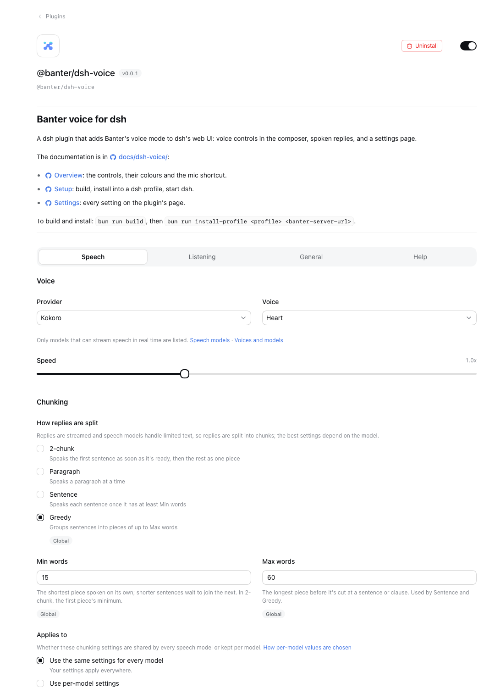

# Settings

The plugin's settings are on its card in dsh's **Plugins** page, in four tabs: Speech, Listening, General and Help. Each setting carries a short description on the page itself, so this page only says where things are.

Edits are staged. **Save** writes them all; **Cancel** discards them. Both stay disabled until something changes. A new session picks up saved settings the next time voice starts.

*The Speech tab, with an example voice roster.*

## Speech

How the reply is spoken.

| Setting | What it does |
|---|---|
| Provider | The text-to-speech server. Shown when the roster has more than one. |
| Model | The speech model on that provider. Shown when there is more than one. Only models that can stream speech are listed. |
| Voice | The voice, from the chosen model's list. |
| Speed | Speaking rate, 0.5x to 2x. |
| Chunking scope | One set of chunking settings for every model, or settings kept per model. |
| Chunking mode | How the reply is cut into pieces to speak: 2-chunk, Paragraph, Sentence or Greedy. |
| Min words, Max words | The shortest and longest piece spoken at a time. |
| Reset to model defaults | Clears the per-model edits for the current model. |
| Playback method | How audio reaches the browser: Auto, MMS, MSE or Blob. Leave on Auto unless speech stutters. Saved in this browser at once, not by Save, and applied when the page reloads. |

## Listening

How your speech is heard and when your turn ends.

| Setting | What it does |
|---|---|
| Transcription provider | The speech-to-text server. |
| Min duration, Min probability | Speech detection: how long and how clearly a sound must be speech to count. |
| Pause | How much silence counts as a pause. |
| Commit min, Commit max | How long to wait after a pause before sending your turn, when you sound finished and when you sound mid-thought. |
| Smart-turn, Smart-turn low | The scores at which the turn-taking model counts you as finished or still going. |

Each slider shows its default until you change it, and has a Reset. For what these do in practice, see [what the settings mean](../pages/voice-interface.md#what-the-settings-mean).

## General

| Setting | What it does |
|---|---|
| Banter server URL | The address of your Banter install, the one you open its dashboard at. The plugin reaches the speech services through it. |
| Always take over | Shown when a speech server serves one session at a time. When another session holds it, take it over without asking. |
| Keep voice on outside a conversation | Voice keeps running when you move to another dsh page, instead of turning off. |

The provider, model and voice lists come from the Banter server when the plugin is installed; run the install step again to refresh them ([setup.md](setup.md#what-install-seeds)).

## Help

Links to these docs and to Banter's setup pages, grouped by topic.
