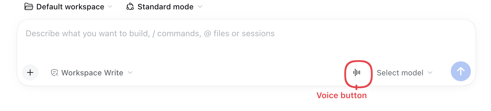
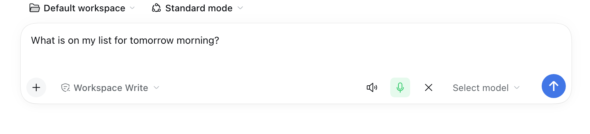

# Voice for dsh

A plugin that adds Banter's voice mode to the web UI of dsh (DeepSeek Harness). dsh keeps the conversation, its composer and its run controls. The plugin adds a few buttons to the composer: you talk, your words appear in the text box and are sent when you finish a turn, and the reply is spoken back. You can cut in while it speaks, and type at any time.

Speech recognition and speech synthesis come from a Banter server you run; see [setup.md](setup.md). The plugin is required to use Banter's voice from DeepSeek Harness; it is the only way to get voice there. It needs that server running and reachable at the URL in its settings: without it, turning voice on fails and the voice button turns the error colour. The plugin's [settings page](settings.md) picks the voice, the transcription provider and how patient the turn-taking is.

## Turn voice on

Install the plugin ([setup.md](setup.md)), then open a conversation in dsh. The waveform button in the composer's tool row turns voice on; the first time, allow microphone access when the browser asks.

*The voice button is the waveform at the right of the composer's tool row.*

Press it. A turning ring shows while voice starts; press it to cancel. Once voice is on, speak.

## The controls

State is shown by colour on the buttons, never by text. Hover a button for its name.

| Button | What it shows |
|---|---|
| Waveform, plain | Voice is off. Press to turn it on. |
| Turning ring | Voice is starting. Press to cancel. |
| Microphone, green | Voice is on and listening. |
| Microphone, green on a green tint | It hears you speaking. |
| Crossed-out microphone, amber | The mic is muted. Press to unmute. |
| Crossed-out microphone, amber outline | The mic is muted because you are typing; see below. |
| Speaker with sound waves, plain | Speech is on. Press to mute speech only. |
| Speaker with sound waves, green tint | The reply is being spoken. |
| Crossed-out speaker, amber | Speech is muted. Press to unmute. |
| Broken chain link | The mic and speech are muted separately. Press to link them again. It appears only then. |
| X | Turn voice off. Red when voice has a problem: hover it for the reason. |

While the mic and speech are linked, the mic button mutes and unmutes both together. Muting speech alone stops the reply being spoken without stopping what the agent does.

*Staged: the page was set into the listening state for this capture, with no microphone or speech service in use.*

If voice cannot start, the waveform button turns red and its tooltip gives the reason. Press it to try again. When another dsh session is using the transcription server, the tooltip says so, and pressing the button takes it over.

## The mic shortcut

The mic has no keyboard shortcut by default. You can give "Mute or unmute the voice mic" a key in dsh's Settings, under General, in Keyboard shortcuts (Edit shortcuts). Once bound, it works from the text box too, and does nothing while voice is off.

## Typing while voice is on

Your speech appears in the composer's text box as you talk, and is sent when your turn ends. If you type in the box:

- The mic mutes itself, so spoken words never land in the middle of your text. The mic button shows the amber outline.
- Your text stays as you typed it; voice does not write over it.
- Press Send as usual and the mute ends: voice goes back to listening.
- Or unmute the mic by hand, with the button or the shortcut. Your text is kept, and what you say next is added after it.

If the box already holds text when voice turns on, voice starts muted in the same way.

## Where next

- [setup.md](setup.md): build, install and start.
- [settings.md](settings.md): every setting on the plugin's page.
