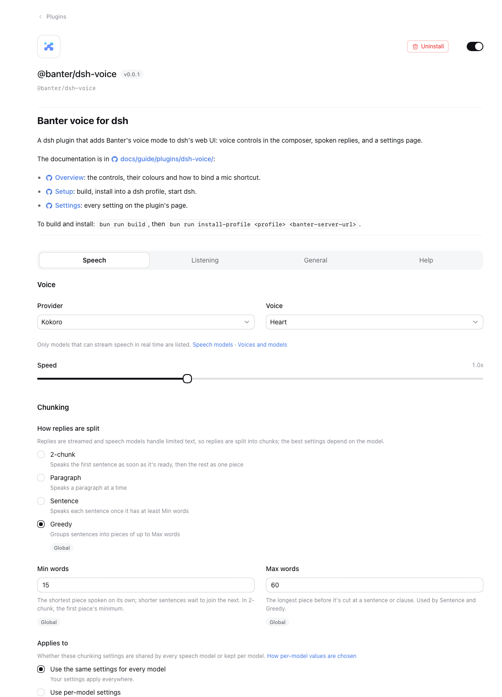

# Settings

The plugin's settings are on its card in dsh's **Plugins** page, on one page with no tabs. Each setting carries a short description on the page itself, so this page only says where things are.

There is no Save button: each setting saves itself. A brief "Saved" appears beside the one that saved, and a refused write shows its reason there.

*The plugin's settings page.*

## Banter server

| Setting | What it does |
|---|---|
| Banter server URL | The address of your Banter install, the one you open it at. The plugin reaches the speech services through it. Saves when you leave the field or press Enter; Escape puts back the saved value. A value that is not an `http://` or `https://` address is not saved, and the problem shows under the field. |

## Service status

One row per check, with its state in words and, when something is wrong, the reason and what to do.

| Row | What it shows |
|---|---|
| Banter | Whether the server at the URL answers. |
| Transcription service, Speech service | Whether each service the voice settings name is running, not running (voice starts it when needed) or unreachable, with the service's name after the badge. A check starts nothing. |
| Microphone | Whether the browser allows the microphone. **Allow microphone** asks for it and releases it at once. |
| This page | Whether the page can use the microphone and run turn detection on more than one thread. |

**Test connection** runs every check again, and saves a pending URL edit first. The checks also run when the page opens and after the URL saves.

## Voice settings

A read-only summary of what is in use, as Banter set it: transcription service with its model and mode (plus, while voice is on, which mode is in use and why), provider, model and voice, speed, chunking mode and take-over, with the time it was loaded. A transcription service or voice that Banter cannot call is shown with the reason under its row; change it in Banter's settings.

- **Reload voice settings** fetches them from Banter again. Banter's settings are also fetched when the page opens, when the page regains focus, and when voice starts; while voice is on, a changed voice selection reconfigures it. A failed reload says why and leaves the settings in use as they were.
- **Open voice settings in Banter** opens Banter's settings dialog in a new tab. Voice selection, transcription service, chunking, take-over and the speech-detection and turn-taking sliders are changed there and apply to every client. Disabled until a URL is saved.

## In dsh

| Setting | What it does |
|---|---|
| Keep voice on outside a conversation | Voice keeps running when you move to another dsh page, instead of turning off. |
| Playback method | How audio reaches the browser: Auto, MMS, MSE or Blob. Leave on Auto unless speech stutters. Saved in this browser at once and applied when the page reloads. |
| Mute shortcut | The mic mute has no default key. Bind it in dsh's keyboard shortcuts settings ([the mic shortcut](README.md#the-mic-shortcut)). |

For what the speech-detection and turn-taking settings do in practice, see [what the settings mean](../../../reference/components/voice-interface.md#what-the-settings-mean).
